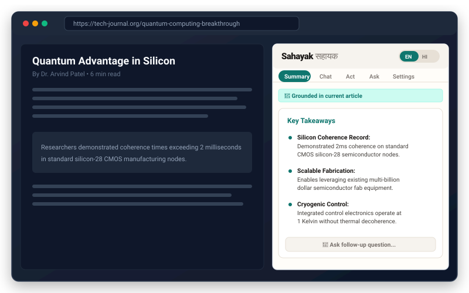
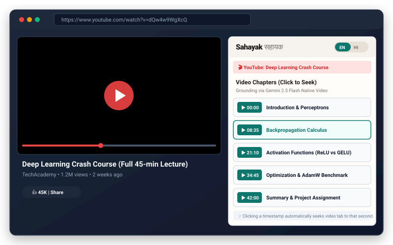
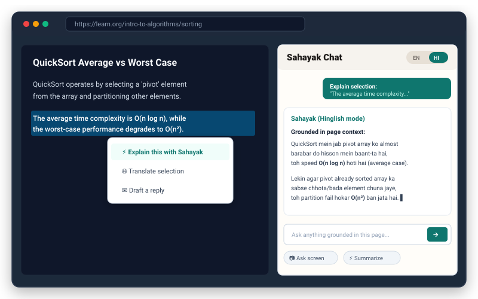
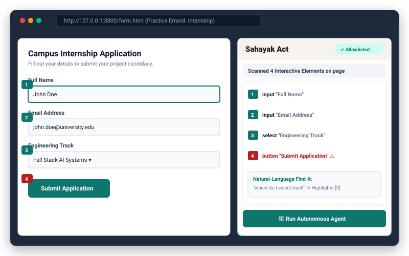
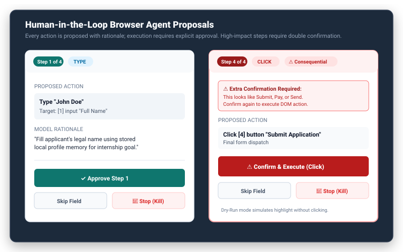
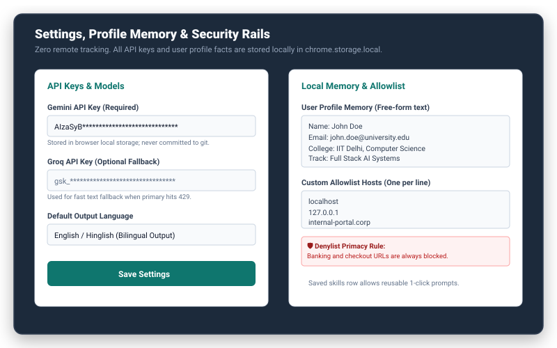

# Sahayak (सहायक) — AI Browser Side-Panel Agent

> **Chrome & Edge Manifest V3 extension that reads articles and YouTube videos, chats grounded in page context, finds controls, and acts with your explicit approval.**

[](LICENSE)
[](https://developer.chrome.com/docs/extensions/mv3/intro/)
[](https://aistudio.google.com/)
[](https://github.com/sahayak-ai/sahayak/releases)

---

## Table of Contents

- [Overview](#overview)
- [Visual Showcase](#visual-showcase)
- [Core Capabilities](#core-capabilities)
- [Installation Guide (Load Unpacked)](#installation-guide-load-unpacked)
- [API Keys & Privacy](#api-keys--privacy)
- [Bilingual Support (English & Hinglish)](#bilingual-support-english--hinglish)
- [Safety Rails & Architecture](#safety-rails--architecture)
- [Testing on Practice Errands](#testing-on-practice-errands)
- [Building the Release ZIP](#building-the-release-zip)
- [Landing Page](#landing-page)
- [Explicitly Out of Scope](#explicitly-out-of-scope)

---

## Overview

Most AI extensions today suffer from two extremes: either they act as passive chatbots disconnected from your page context, or they attempt dangerous autonomous agent actions without asking permission.

**Sahayak** (Sanskrit/Hindi for *"Helper"* or *"Assistant"*) is designed from the ground up as a **human-in-the-loop pair programmer for the web**:
1. **Reads & Grounds**: Extracts article content and public YouTube video streams with zero hallucinations — admitting when an answer is not on the page.
2. **Finds & Maps**: Detects buttons, inputs, links, and dropdowns, placing clear, numbered badges over interactive controls.
3. **Acts With Approval**: Proposes exactly one next action at a time with rationale. You inspect, dry-run, approve, skip, or kill every single step.

---

## Visual Showcase

### 1. Grounded Article Reading
*Uses Mozilla Readability to distill the essence of articles into structured takeaways, with follow-up chat.*


---

### 2. Native YouTube Video Understanding & Chapter Seeking
*Direct multimodal processing via Gemini 2.5 Flash; click any chapter pill to seek the video tab.*


---

### 3. Selection Actions & Bilingual Hinglish Chat
*Select any paragraph to Explain, Translate, or Draft a reply, with seamless English/Hinglish toggle.*


---

### 4. Numbered Interactive Action Map
*Scans interactive page controls and renders numbered badges for visual clarity and model reasoning.*


---

### 5. Action Proposal Cards & Consequential Double Confirmation
*Proposals detail action type, target element, and rationale. Consequential steps (Submit, Pay, Send) require extra confirmation.*


---

### 6. Local Settings, Profile Memory & Denylist Primacy
*Zero remote telemetry. API keys and user profile facts are kept strictly inside your browser sandbox.*


---

## Core Capabilities

| Feature | Description |
|---|---|
| **📄 Article Summaries** | Strips clutter with Mozilla Readability; presents concise key takeaways grounded strictly in text. |
| **🎬 YouTube Video Chapters** | Multimodal analysis using Gemini 2.5 Flash. Generates interactive timestamp pills that seek the video tab on click. |
| **💬 Grounded Chat** | Streams answers grounded in the active tab. Refuses to speculate on off-page content with explicit `off_page` signals. |
| **⚡ Right-Click Context Menus** | Context menu items for selected text: *Explain this with Sahayak*, *Translate selection*, and *Draft a reply*. |
| **📷 Screenshot-and-Ask** | Capture the visible tab, crop an area of interest, and ask visual questions. |
| **🎯 Natural-Language Find-it** | Type what you're looking for (e.g. *"where is submit button"*); Sahayak outlines the target element and scrolls it into view. |
| **🤖 Autonomous Agent** | Multi-step errand loop running on allowlisted hosts. Proposes one action at a time with verifiable reasoning. |
| **🔬 Dry-Run Simulation** | Highlighting-only mode that simulates clicks and form typing without mutating the live DOM. |
| **📋 Action Audit Log** | Comprehensive session history tracking proposed steps, decisions (`approved`, `dry_run`, `skipped`, `stopped`, `blocked`), and outcomes. |
| **🧠 Local Memory & Skills** | Stores applicant profile data (name, email, portfolio) and reusable custom skills (`⚡ Summarize`, `⚡ Extract Key Facts`). |

---

## Installation Guide (Load Unpacked)

Sahayak runs on **Google Chrome**, **Microsoft Edge**, **Brave**, and any Chromium-based browser supporting Manifest V3.

### Option A: Install from Pre-Packaged Release ZIP
1. Download `sahayak-extension.zip` (or `sahayak-v0.1.0.zip`) from [Releases](https://github.com/sahayak-ai/sahayak/releases).
2. Extract the ZIP file to a folder on your computer (e.g. `sahayak-dist/`).
3. Open your browser and navigate to:
   - Chrome: `chrome://extensions`
   - Edge: `edge://extensions`
   - Brave: `brave://extensions`
4. Toggle on **Developer mode** in the top-right corner.
5. Click **Load unpacked** and select the extracted folder.
6. Click the extensions puzzle icon in your browser toolbar and pin **Sahayak**.

### Option B: Build from Source
```bash
# 1. Clone the repository
git clone https://github.com/sahayak-ai/sahayak.git
cd sahayak

# 2. Install dependencies & run test suite
npm install
npm test

# 3. Build the production extension
npm run build
```
Load the generated `dist/` directory as an unpacked extension using Step 3–5 above.

---

## API Keys & Privacy

### 1. Where to Get API Keys
- **Google Gemini API Key (Required)**: Get a free API key at [Google AI Studio](https://aistudio.google.com/app/apikey).
- **Groq API Key (Optional Fallback)**: Get a key at [Groq Console](https://console.groq.com/keys). Used automatically as a high-speed fallback for eligible text tasks if rate limits occur.

### 2. Enter Keys in Settings Panel
1. Open the Sahayak side panel by clicking the extension icon in your browser toolbar.
2. Click the **Settings** tab.
3. Paste your Gemini API key (and optional Groq key).
4. Click **Save Settings**.

### 3. Privacy Guarantee
- **Never committed to git**: `.gitignore` strictly excludes all `.env` and `.env.*` files. A non-secret template is provided in [`.env.example`](.env.example).
- **Stored in `chrome.storage.local`**: Keys and profile memory live exclusively inside your browser's private local storage. Requests are dispatched directly from your browser to Google / Groq over encrypted HTTPS.
- **No telemetry**: There is no remote tracking, no analytics script, and no intermediary Sahayak backend server.

---

## Bilingual Support (English & Hinglish)

- **Header Toggle**: Switch between **EN** (English) and **HI** (Hinglish) at any time from the top header bar.
- **Hinglish Responses**: Technical explanations and summaries are phrased in natural Hindi-English conversational tone (e.g. *"QuickSort mein average time complexity O(n log n) hoti hai, lekin worst case O(n²) ban sakta hai"*).
- **Translate Selection**: Right-click any text on the web and choose **Translate selection** to view translations into Hindi or your configured target language without altering global settings.

---

## Safety Rails & Architecture

Sahayak enforces strict, deterministic security boundaries in code:

1. **Denylist Primacy**:
   - Banking, checkout, payment, UPI, wallet, and authentication URLs are classified as `sensitive`.
   - On sensitive pages, summary extraction, screenshot capture (`Ask screen`), and autonomous browser actions (`page/act`) are completely disabled.
   - **The denylist always wins over the allowlist**; adding a banking hostname to your custom allowlist will still result in refusal.
2. **Protected Fields Guard**:
   - Fields classified as `password`, `otp` / `totp` (`autocomplete="one-time-code"`), or credit card (`cc-number`, `cvv`) are strictly blocked.
   - The agent is prevented from typing into any protected field, immediately halting with a `protected_field` alert.
3. **Consequential Action Double Confirmation**:
   - High-impact buttons matching `submit`, `pay`, `send`, `place order`, or `confirm payment` trigger an extra confirmation prompt:
     > `⚠️ Extra Confirmation Required: This looks like Submit, Pay, or Send. Confirm again to continue.`
4. **Persistent Kill Switch**:
   - A prominent emergency stop button (`🛑 Stop Run`) is always visible during agent runs, immediately cancelling further actions.
5. **Host Allowlist**:
   - Browser actions only execute on allowlisted hostnames (`localhost` and `127.0.0.1` by default). Additional trusted hostnames can be configured in **Settings**.

---

## Testing on Practice Errands

Sahayak includes a local practice environment with 3 safe mock tasks to verify agent capabilities:

### 1. Launch the Practice Server
```bash
npm run serve:practice
```
*(Runs on `http://127.0.0.1:3000/`)*

### 2. Available Practice Scenarios
- **Internship Application (Apply Errand)**: [`http://127.0.0.1:3000/form.html`](http://127.0.0.1:3000/form.html)
  - Goal: *"Fill form with my name and email from profile, select AI track, and submit"*
  - Tests element scanning, profile population, and consequential submit double-confirmation.
- **Campus Store (Shop Errand)**: [`http://127.0.0.1:3000/shop.html`](http://127.0.0.1:3000/shop.html)
  - Goal: *"Add hoodie size L to cart and proceed to review"*
  - Tests button clicking, quantity adjustment, and cart interaction.
- **Fact Gathering (Collect Errand)**: [`http://127.0.0.1:3000/collect1.html`](http://127.0.0.1:3000/collect1.html)
  - Goal: *"Find the library opening hours on weekends and extract contact email"*
  - Tests grounded reading, information extraction, and follow-up Q&A.

---

## Building the Release ZIP

To generate a clean production release archive containing only runtime extension files:

```bash
npm run zip
```

This compiles TypeScript (`tsc --noEmit`), builds optimized bundle chunks via Vite, and packages `dist/` into:
- `release/sahayak-v0.1.0.zip` (Versioned archive)
- `release/sahayak-extension.zip` (Latest pointer)

Excluded automatically: `node_modules/`, source TypeScript files, `.env*` secrets, tests, and git metadata.

---

## Landing Page

A self-contained GitHub Pages landing page featuring an interactive **30-second live browser simulator** is located in:
- [`docs/index.html`](docs/index.html)
- [`site/index.html`](site/index.html)

To preview the landing page locally:
```bash
npx serve docs -l 8080
```
Open `http://localhost:8080/` in your browser.

---

## Explicitly Out of Scope

In accordance with Sahayak's security design principles, the following are deliberately out of scope:
- Mobile browsers (Chrome on iOS/Android).
- Unrestricted autonomous execution without human approval.
- Automated banking, checkout, or login authentication.
- Automated typing of passwords, OTP codes, or payment card details.
- Transmitting private or financial page data to third-party free-tier cloud relays.
- Remote telemetry, user tracking, or centralized logging servers.
- Chrome Web Store public distribution (distributed as developer-mode unpacked extension).

---

## License

MIT License. Designed and developed for open, safe, and privacy-respecting browser AI assistance.
